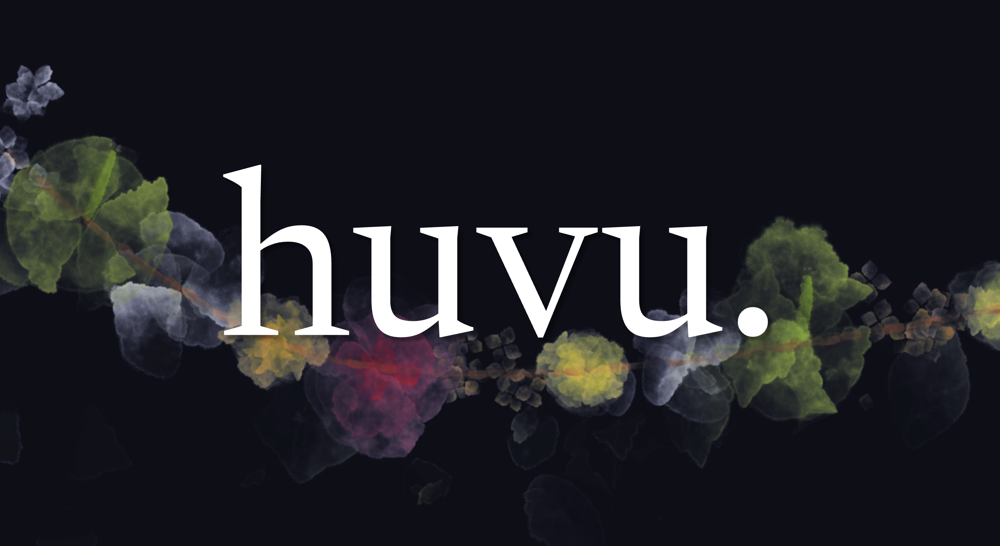

# huvu

huvu is a proactive agent harness that learns your behaviours and cares for you.

features:
- every action of your life is a data point stored in sqlite.
- exposed mcp to query this data.
- trigger engine that runs a script and/or invokes an agent when a certain condition on this data is met.
- nightly dreams that find patterns in this data and suggest triggers that will work for you.

huvu supports for user groups, comes with a full fledged android app. it runs hermes internally, so whatever works with hermes, works with huvu.

huvu allows for pluggable "drivers", that act as sources of data about your life and behaviours to huvu. it learns from this data, and can act on changes here. when combined with hermes' ecosystem and memory, it acts as an extremely robust agent that doesn't need you to spoonfeed desiderata.

you only pay for hermes inference. everything else runs either locally or comfortably in the free tier of a host of providers.

## available drivers
- home assistant for home automation
- owntracks for private location tracking

## features
- approval and transparency. every action exposed by the mcp is either silent, notify, or ask.
- hands free voice mode. currently runs on Whisperv3-large served by Groq for STT and microsoft edge TTS. the entire setup is comfortably free.
- really good UI. huvu paints a flower garland each session that you talk to it. huvu (ಹೂವು) is kannada for flower.
- dockerized. clone it. point claude/codex to it. you'll have it set up in five minutes tops.
- website, firetv app, android app and iphone (home screen) app.
- cache optimal model escalator
- give each family member their own agent. huvu supports user groups and has group scoped sessions for common devices (e.g., tv) with an option to escalate a session to your own user via phone approval.
- rich output support, including choices, image and video feeds

## upcoming
- immich driver
- widgets
- wake word suppport
- echo dot esque hardware
